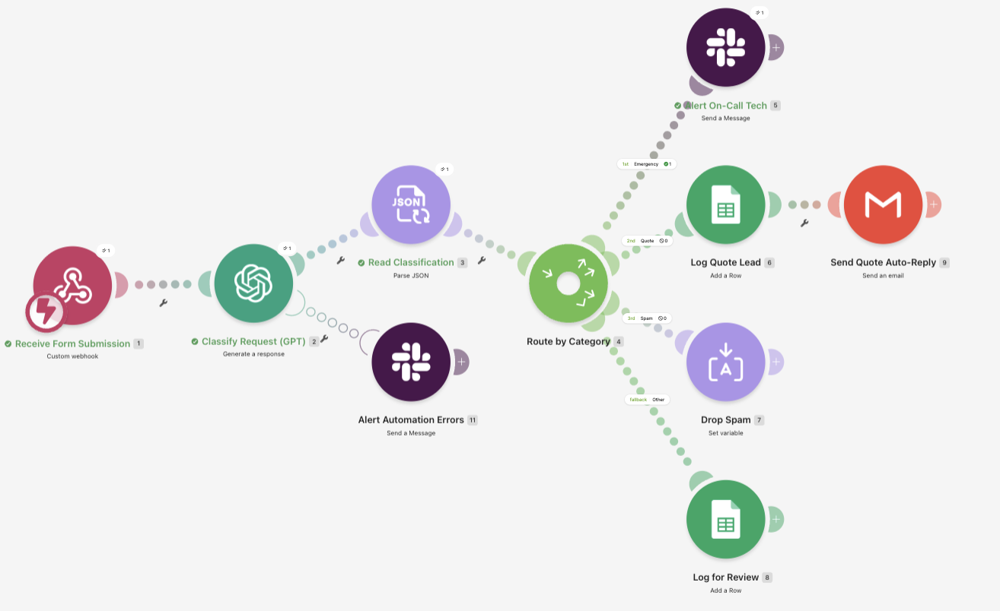
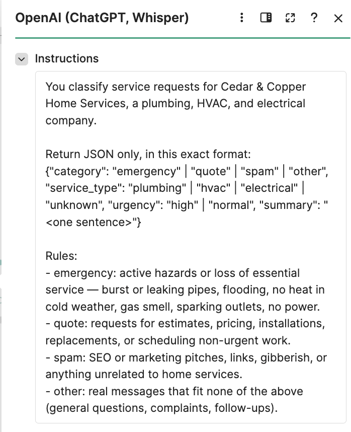
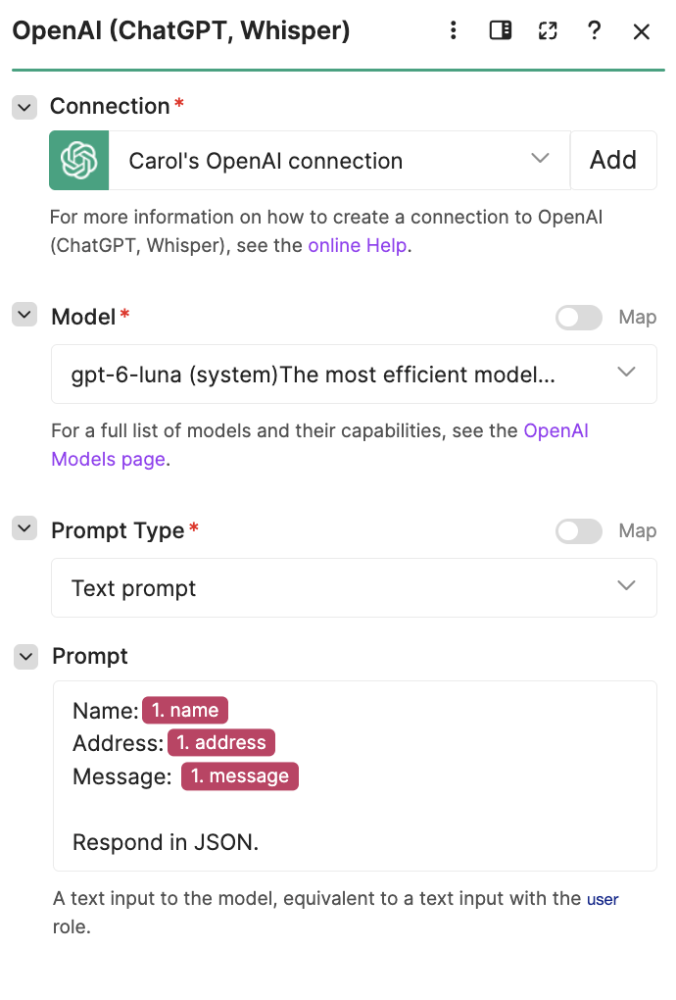
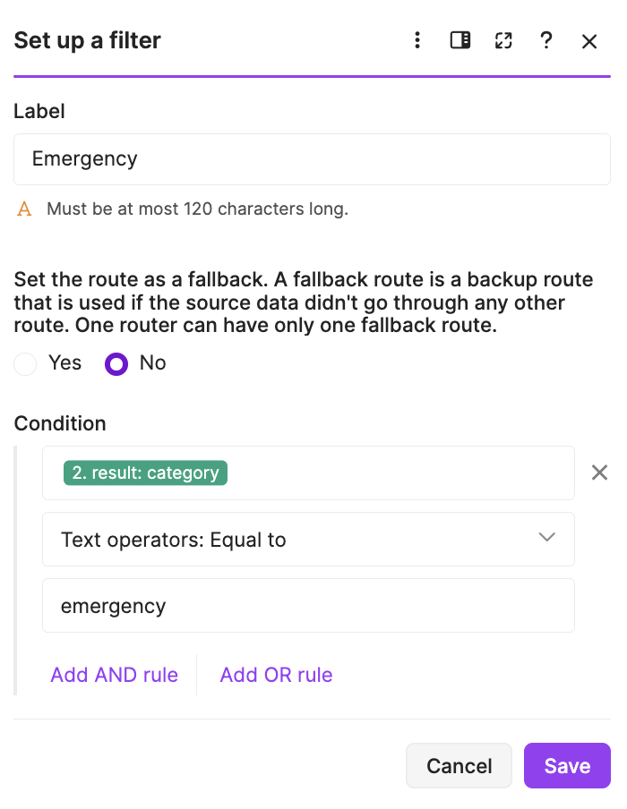
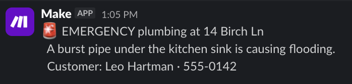
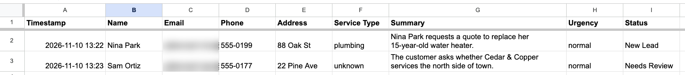
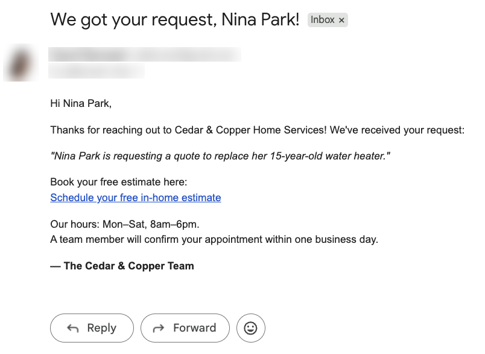
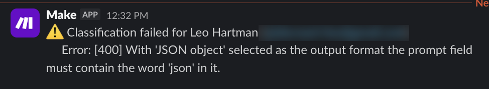
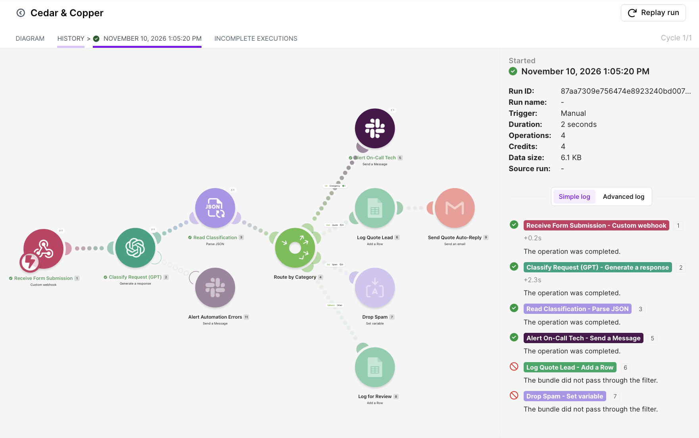

# AI Service Request Router for a Home Services Company

An AI-powered intake automation built in **Make.com**. It reads every website form submission, classifies it with GPT, and routes it automatically: emergencies go to the on-call technician in Slack, quote requests become leads with an instant auto-reply, spam is dropped, and anything unclear is flagged for review.

**Client (demo):** Cedar & Copper Home Services, a fictional plumbing, HVAC and electrical company
**Built with:** Make.com · OpenAI (GPT-6 Luna) · Slack · Google Sheets · Gmail · Calendly

▶ **[Watch the 2-minute walkthrough on Loom](https://www.loom.com/share/fbaefb079eed4163a590cfd6f797f001)**



---

## The problem

Home services companies receive every kind of request through one website form: a burst pipe at 2am, a homeowner shopping for a new water heater, a general question, and a steady stream of spam. When it all lands in one inbox, urgent jobs wait behind routine ones, quote requests go cold before anyone replies, and staff waste time sorting junk.

For this kind of business, a missed emergency means a lost customer and possibly property damage. A slow reply to a quote request usually means the job goes to a competitor.

## The solution

The automation reads every submission the moment it arrives, uses AI to work out what kind of request it is, and sends it to the right place, with no one needing to check an inbox first.

| Category | What happens |
|---|---|
| 🚨 **Emergency** (burst pipe, no heat, gas smell, sparking outlet) | Instant Slack alert to `#on-call-dispatch` with the address, a summary and the customer's phone number |
| 💬 **Quote request** | Logged as a **New Lead** in Google Sheets, and the customer gets a branded email with a link to book a free estimate |
| 🗑️ **Spam** | Recognized and dropped, so it never reaches staff |
| ❓ **Other / unclear** | Logged as **Needs Review**, so no real customer slips through |
| ⚠️ **Failure** | Alert posted to `#automation-errors`, so problems never go unnoticed |

## How it works

1. **Intake:** The website form sends each submission (`name`, `email`, `phone`, `address`, `message`) to a Make **custom webhook**.
2. **Classification:** **GPT-6 Luna** reads the message and returns structured JSON:
   ```json
   {"category": "emergency", "service_type": "plumbing", "urgency": "high", "summary": "A burst pipe under the kitchen sink is causing flooding."}
   ```
   The instructions define clear rules for each category so results stay consistent.
3. **Parsing:** A **Parse JSON** module turns the response into fields the router can filter on.
4. **Routing:** A **Router** sends each request down one of four paths. The **Other** path is set as the **fallback route**, so it only catches requests no other filter matches.
5. **Error handling:** An **error handler** on the AI step posts any failure to Slack, and incomplete executions are stored so failed runs can be replayed.

| Classification instructions | Mapped prompt |
|---|---|
|  |  |

<p align="center"></p>

## Results

Tested end to end with four representative requests. Each was routed correctly:

| Test request | Classified as | What happened |
|---|---|---|
| "Pipe burst under the kitchen sink, water everywhere!" | Emergency · plumbing · high | Slack alert within seconds |
| "Looking for a quote to replace our 15-year-old water heater." | Quote · plumbing · normal | New Lead row plus an auto-reply with a booking link |
| "Get your website to #1 on Google!!! Click here now" | Spam | Dropped, with no alert, row or email |
| "Do you guys service the north side of town?" | Other | Needs Review row |

Each run completed in **2–4 seconds**, and classification costs a fraction of a cent per request.

### What each route produces

**Emergency → Slack alert to the on-call technician**



**Quote → lead logged in Google Sheets** (customer emails blurred)



**Quote → branded auto-reply with a booking link**

<p align="center"></p>

**Failure → alert in `#automation-errors`**



**Execution log:** every step completed, and the Quote and Spam routes were correctly filtered out



### What this means for the business

- Emergencies reach a technician in seconds instead of waiting in an inbox.
- Every quote request gets an instant, professional reply, at any hour.
- All leads land in one organized sheet, ready for follow-up.
- Staff never see spam.

## Challenges and what I learned

- **Structured AI output:** OpenAI's JSON mode requires the word "JSON" in the prompt itself. Without it, requests are rejected. I used this real error to test the error handler.
- **Fallback routing:** A router branch with no condition runs for *every* request. Marking it as the fallback route made it catch only unmatched requests, which prevented emergencies from also being logged for review.
- **Formatting details:** Converting the auto-reply to HTML and using Make's `formatDate()` for timestamps made the outputs look like a real business system, not a prototype.

## What I'd add next

- SMS alerts to the on-call technician (e.g. via Twilio) for after-hours emergencies
- An on-call rotation schedule so alerts go to whoever is on duty
- Pushing quote leads into a CRM such as HubSpot or Jobber
- A daily Slack summary of new leads and anything still marked Needs Review
- Strict JSON schema output and a lower temperature for even more consistent classification

## Try it yourself

1. In Make, create a new scenario and choose **⋯ → Import Blueprint**.
2. Upload [`blueprint/cedar-copper-service-request-router.blueprint.json`](blueprint/cedar-copper-service-request-router.blueprint.json).
3. Connect your own accounts: **OpenAI**, **Slack**, **Google Sheets** and **Gmail**. No credentials are included in the blueprint.
4. Create a Google Sheet with these columns: `Timestamp | Name | Email | Phone | Address | Service Type | Summary | Urgency | Status`
5. Create the Slack channels `#on-call-dispatch` and `#automation-errors`, and invite the Make bot to both.
6. Copy your new webhook URL and send a test submission with the fields `name`, `email`, `phone`, `address` and `message`.

---

*Portfolio project. Cedar & Copper Home Services is a fictional company, and all customer data shown is test data.*
